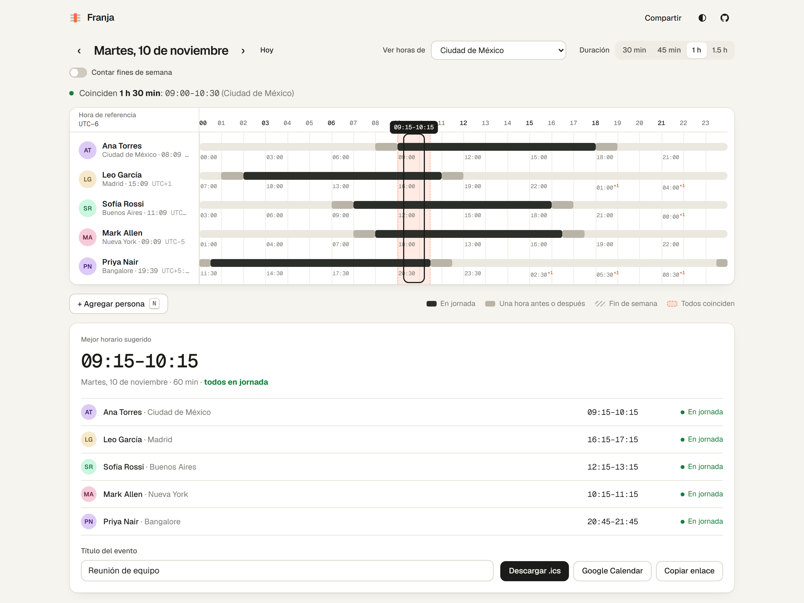

# Franja

**Encuentra la hora en la que todo tu equipo coincide.**

Franja es un planificador de reuniones entre zonas horarias. Agregas a cada persona con su ciudad y su horario laboral; Franja calcula la franja común, sugiere el mejor horario, avisa de los próximos cambios de horario y exporta la invitación a tu calendario.

Sin cuentas ni servidor: el equipo completo vive en el enlace.

🔗 **Demo:** https://christianivandev.github.io/franja/

<a href="https://christianivandev.github.io/franja/">
  <picture>
    <source media="(prefers-color-scheme: dark)" srcset="docs/franja-oscuro.png">
    
  </picture>
</a>

---

## Qué hace

- **Todas las zonas horarias del mundo**: 420 zonas IANA en 247 países y territorios, con los 38 desfases que existen, de UTC−12 (islas Baker y Howland) a UTC+14 (Kiritimati).
- **Búsqueda flexible**: por ciudad o país en español y sin importar acentos («japon», «Chile»), por desfase («UTC+5:45», «gmt-3», «+0530») o por abreviatura («EST», «CET», «IST», «JST»).
- **Explorador del mundo**: todas las zonas agrupadas por desfase, con una tira que muestra cuántas zonas comparten cada hora.
- **Línea de tiempo de 24 h** por persona, alineada a la zona que elijas, con la hora local de cada uno a la vista.
- **Franja común resaltada** y resumen en texto: «Coinciden 2 h: 09:00–11:00».
- **Sugerencia automática** del mejor horario. Si no hay coincidencia total, propone el bloque con más gente y evita que quien no puede asistir quede en plena madrugada.
- **Selección arrastrando** o con teclado (`←` `→` mueven la reunión, `Mayús` + flechas cambian la duración).
- **Fines de semana reales**: cuando en Ciudad de México es viernes por la tarde, en Tokio ya es sábado.
- **Avisos de horario de verano** para los próximos 30 días.
- **Exportar** a `.ics` (Outlook, Apple Calendar) o directo a Google Calendar, con la hora de cada persona en la descripción.
- **Compartir por URL**: el estado se codifica en el hash. Abrir el enlace muestra exactamente el mismo equipo.
- Modo claro y oscuro, diseño adaptable a móvil y atajos de teclado (`N`, `[`, `]`, `T`).

## Decisiones técnicas

### Cero dependencias para fechas
Toda la lógica de zonas horarias (`src/lib/time.ts`) se apoya únicamente en `Intl.DateTimeFormat`, que ya trae la base de datos IANA del navegador. Esto evita cargar decenas de KB de datos de zonas y siempre está actualizado.

Casos difíciles cubiertos con tests:

| Caso | Ejemplo |
|---|---|
| Desfases de media hora y de 45 min | India (UTC+5:30), Nepal (UTC+5:45), isla Lord Howe (su horario de verano solo adelanta 30 min) |
| Días de 23 y 25 horas | Cambio de horario en Nueva York |
| Horas que no existen | 02:30 del 8 de marzo en Nueva York pasa a 03:30 |
| Jornadas que cruzan medianoche | Turno de 22:00 a 06:00 |
| Persona en otro día civil | Auckland ya está «mañana» |

### Catálogo mundial generado, no descargado
`scripts/generate-zones.mjs` construye `src/lib/zones.json` (10 KB) con el propio `Intl` de Node, sin descargar la base de datos de zonas:

- `Intl.supportedValuesOf('timeZone')` da la lista de zonas.
- `new Intl.Locale('und-JP').getTimeZones()` dice qué zonas tiene cada país.
- Se descartan los códigos ISO retirados que ICU todavía conserva (como `JT` para la isla Johnston) y se normalizan los nombres antiguos (`Asia/Calcutta` → `Asia/Kolkata`).
- Se agrega UTC−12, el único desfase del planeta que no tiene ninguna zona habitada.

Los nombres de los países salen de `Intl.DisplayNames` en español. Un test verifica que el catálogo incluye cada zona que conoce el motor, que cada desfase existe y que ninguna zona queda sin nombre de país.

### Bloques de 15 minutos
El día se divide en bloques de 15 minutos de la zona de referencia, no en 96 fijos: en un día con cambio de horario hay 92 o 100. Así, Nepal y los días de 23 h se ven correctamente.

### Estado en la URL, validado
`src/lib/share.ts` serializa el equipo a JSON compacto en Base64URL (con soporte para acentos y emojis vía `TextEncoder`). Al leerlo **no se confía en la entrada**: se validan las zonas, se acotan los minutos y se limita la cantidad de personas y la longitud de los textos.

### Calendario estándar
`src/lib/calendar.ts` genera archivos `.ics` siguiendo RFC 5545: escapado de caracteres, saltos `CRLF` y plegado de líneas a 75 octetos.

### Accesibilidad
La línea de tiempo es un `role="slider"` operable por teclado con `aria-valuetext` legible («09:15–09:45»). El buscador de ciudades es un combobox ARIA completo. Se respeta `prefers-reduced-motion`.

## Estructura

```
src/
├── lib/
│   ├── time.ts        # Núcleo de zonas horarias (solo Intl)
│   ├── schedule.ts    # Disponibilidad, solapamiento y sugerencias
│   ├── share.ts       # Estado ⇄ URL
│   ├── calendar.ts    # .ics y Google Calendar
│   ├── cities.ts      # Catálogo mundial, nombres en español y búsqueda
│   ├── zones.json     # 420 zonas con su país (generado)
│   └── lib.test.ts    # Tests de la lógica
├── components/
│   ├── Timeline.tsx        # Línea de tiempo interactiva
│   ├── PersonForm.tsx      # Alta y edición con combobox de ciudades
│   ├── ZoneExplorer.tsx    # Todas las zonas agrupadas por desfase
│   ├── SelectionPanel.tsx  # Detalle por persona y exportación
│   └── Avatar.tsx
├── App.tsx
└── styles.css         # Tokens de diseño, modo claro y oscuro
```

## Desarrollo

```bash
npm install
npm run dev        # servidor local
npm test           # tests con Vitest
npm run typecheck  # TypeScript estricto
npm run build      # build de producción
npm run zones      # regenera el catálogo de zonas
```

Cada push a `main` pasa por GitHub Actions (tipos, tests y build) y se publica en GitHub Pages.

## Stack

React 18 · TypeScript (estricto) · Vite · Vitest · CSS con tokens propios · GitHub Actions · GitHub Pages

## Próximos pasos

- [ ] Reuniones recurrentes con vista semanal
- [ ] Días laborables configurables por persona (p. ej. domingo a jueves)
- [ ] PWA instalable con soporte offline
- [ ] Tests end-to-end con Playwright

---

Hecho por [Christian Ivan Espinoza Gaytan](https://github.com/ChristianIvanDev). Licencia MIT.
